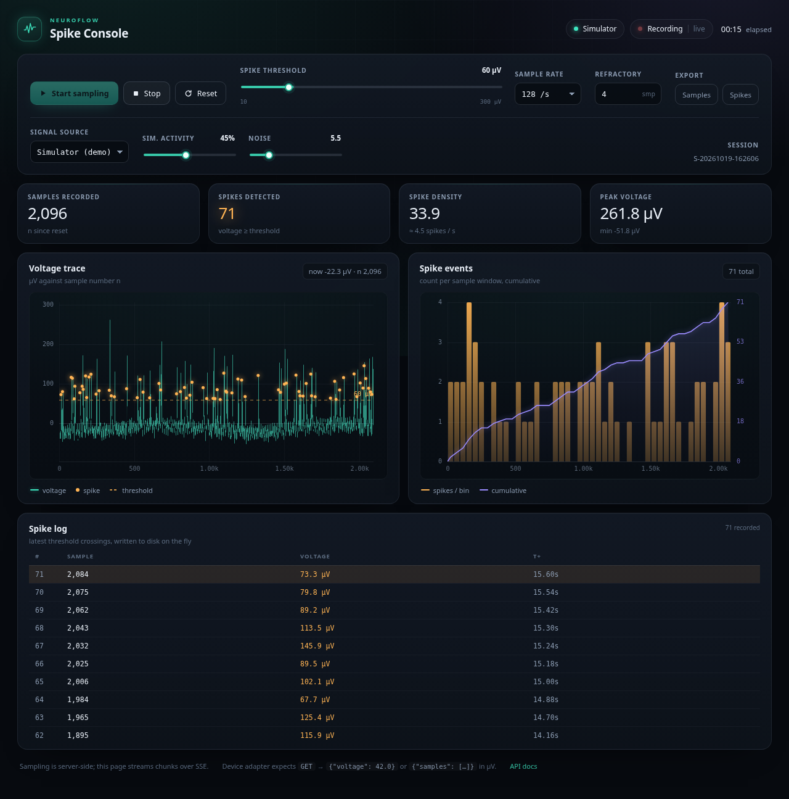

# Neuroflow Spike Console

A local control panel for sampling a Neuroflow signal, recording threshold crossings as
neural spikes, and watching the result live. Two charts update against **n = samples
recorded since reset**:

1. **Voltage trace** — every recorded sample in µV, with the spike threshold and the
   detected spikes marked on top.
2. **Spike events** — spike counts per sample window (bars) plus the running total
   (violet line) over the same n axis.



## Run

```bash
cd neuroflow-panel
pip install -r requirements.txt
./run.sh                      # http://127.0.0.1:8765
```

Python 3.10+. The server binds to loopback only and needs no other services.

## Using it

| Action | Notes |
|---|---|
| **Start / Stop** | Sampling runs server-side, so the recording survives page reloads. Keyboard: `S`. |
| **Reset** | Clears the session after a confirm. Export first if you need the data. Keyboard: `R`. |
| **Spike threshold** | 10–300 µV, applied live. Sliding it re-scores *future* samples only. |
| **Sample rate** | 64 / 128 / 256 / 512 samples per second. |
| **Refractory** | Minimum samples between two spikes (stops one spike counting twice). |
| **Sim. activity / Noise** | Simulator-only: firing density and baseline noise σ. |
| **Export** | `samples.csv` / `spikes.csv` for the current session. |

Detected spikes are appended to `data/session-<UTC timestamp>/spikes.csv` as they happen,
so a crash does not lose them.

## Feeding it real Neuroflow data

There is no public Neuroflow HTTP API documented, so the app has a two-part input layer:
a built-in simulator (default) and an HTTP adapter for whatever stream you have. Pick
**Signal source → Neuroflow device** and give it a URL; the panel polls `GET <url>` about
16 times per second and accepts any of these JSON shapes, all in **microvolts**:

```json
{"voltage": 42.0}
{"value": 42.0}
{"uv": 42.0}
{"samples": [12.4, 88.1, 3.0]}
[12.4, 88.1, 3.0]
{"channels": {"ch1": 42.0, "ch2": 1.0}}   // first numeric channel is used
```

If your Neuroflow stream speaks LSL, serial, or a vendor SDK instead, implement a class
with the same three members as `DeviceSource` in `neuroflow.py` (`read(count, dt,
activity, noise_uv)`, `reset()`, `status`) and assign it in `Recorder.apply_config`.

Two behaviours worth knowing:

- The adapter polls once per sampling chunk (~60 ms). An endpoint that returns a **single
  value per request** therefore caps out near 16 samples/s; one that returns an **array**
  of everything since the last poll sustains the configured rate. `n` always reflects what
  was actually recorded, so the charts stay honest either way.
- Unreachable endpoints surface in the pill and a notice inside the control panel.

### Test device mode without hardware

```bash
python3 mock_device.py --port 8087 --rate 128   # synthetic, Neuroflow-shaped JSON
```

Then choose **Neuroflow device** and use `http://127.0.0.1:8087/sample` (array shape) or
`http://127.0.0.1:8087/single` (single-value shape).

## Spike rule

A spike is recorded when the signal crosses the threshold **going upward** and at least
`refractory` samples have passed since the previous spike. Being above the threshold does
not keep triggering; the signal must come back down first.

## API

| Method | Path | Purpose |
|---|---|---|
| GET | `/api/state` | n, spike total, elapsed, config, source health |
| GET | `/api/history` | full sample buffer + spikes (used to restore the page) |
| GET | `/api/spikes?limit=50` | latest spikes |
| GET | `/api/stream` | SSE: sample chunks, config/state changes, resets |
| POST | `/api/start`, `/api/stop`, `/api/reset` | recording control |
| POST | `/api/config` | partial config patch, validated and clamped |
| GET | `/api/export/samples.csv`, `/api/export/spikes.csv` | downloads |
| GET | `/docs` | generated OpenAPI docs |

## Layout

```
app.py              FastAPI routes, SSE hub, sampler lifecycle
neuroflow.py        config, detector, simulator, device adapter, recorder, sampler thread
mock_device.py      synthetic Neuroflow-shaped HTTP source for adapter tests
test_core.py        detector / recorder / export / config checks (no server needed)
static/             index.html, app.js (canvas charts), style.css
data/               per-session spike logs (created at runtime)
```

## Limits

- The recorder holds 400,000 samples in memory (~52 min at 128 Hz). Older samples are
  dropped from the live view; the spike log on disk is unaffected.
- The simulator is synthetic, not real neural data.
- Single-user local tool: no authentication, CORS, or TLS.
